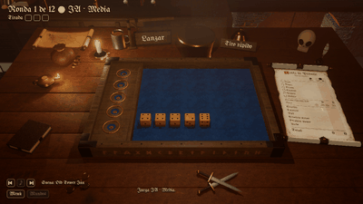
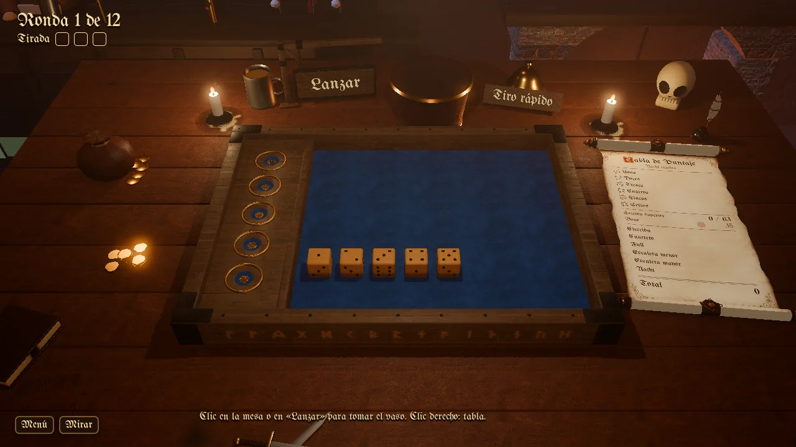
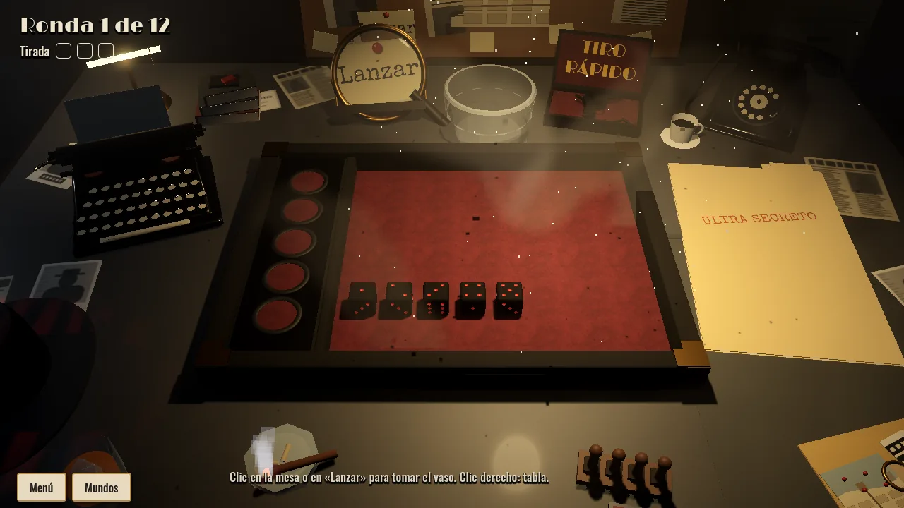
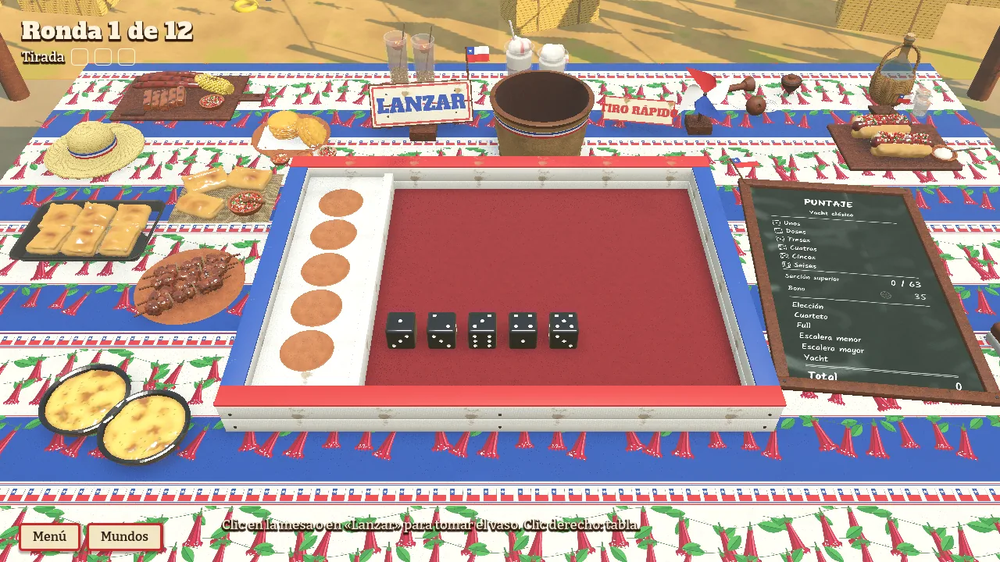

**English** · [Español](README.es.md)

# ParaDice of Fortune

A 3D dice game based on Yacht, the public-domain ancestor of Yahtzee, made in Godot 4 with GDScript. You grab the cup, shake it and let the dice roll on a table with real physics; then you hold the dice you want, roll again up to three times and fill in the score sheet.

Each table belongs to a **world** with its own look, sound and life: a candle-lit fantasy inn, a Frutiger Aero meadow under a glass table, a 1940s detective's office and a Chilean Independence Day fonda.

*Playing against the AI at the Oak Inn.*

> This is a **showcase** repository: it holds screenshots, the project's evolution and its roadmap. The game's code, scenes, models, textures and audio are not published here.

## Where it stands

- Solo play, against the AI (three difficulty levels) or two players on the same computer.
- Two rule sets: classic Yacht with the upper bonus, and modern Yacht.
- Four finished worlds, each with its own pieces, table objects, room, ambience and music.
- Coins, a shop, daily and weekly missions, and a records board.
- Spanish and English.
- Windows (mouse) and, in progress, a personal Android build played by touch.

## Phases

| Phase | Title | Dates | Status |
|---|---|---|---|
| 0 | [Audit and visual direction](EVOLUTION.md#phase-0-audit-and-visual-direction) | 2026-09-26 | Closed |
| 1 | [Foundations](EVOLUTION.md#phase-1-foundations) | 2026-09-26 | Closed |
| 2 | [Playable core](EVOLUTION.md#phase-2-playable-core) | 2026-09-26 | Closed |
| 3 | [The Oak Inn and the interface](EVOLUTION.md#phase-3-the-oak-inn-and-the-interface) | 2026-09-26 / 2026-09-27 | Closed |
| 4 | [Audio](EVOLUTION.md#phase-4-audio) | 2026-09-27 | Closed |
| 5 | [Art and the pieces system](EVOLUTION.md#phase-5-art-and-the-pieces-system) | 2026-09-27 / 2026-09-28 | Closed |
| 6 | [Economy, shop and a second world](EVOLUTION.md#phase-6-economy-shop-and-a-second-world) | 2026-09-28 / 2026-10-02 | Closed |
| 6B | [Third world: the noir office](EVOLUTION.md#phase-6b-third-world-the-noir-office) | 2026-10-02 / 2026-10-04 | Closed |
| 6C | [Fourth world: Fonda El Cacho](EVOLUTION.md#phase-6c-fourth-world-fonda-el-cacho) | 2026-10-13 / 2026-10-15 | Closed |
| 7A | [Versus the AI and two players](EVOLUTION.md#phase-7a-versus-the-ai-and-two-players) | 2026-10-16 / 2026-10-17 | Closed |
| M | [Android](EVOLUTION.md#phase-m-android) | 2026-10-17 / 2026-10-18 | In progress |
| 7B | Online, 1 versus 1 | — | Planned |
| 7C | Three to four players | — | Planned |
| 8 | Progression and endgame | — | Planned |
| 9 | Fifth world: the gothic crypt | — | Planned |

## Worlds

### [The Oak Inn](worlds/posada.md)

### [Frutiger Aero](worlds/aero.md)

### [Midnight Agency (noir office)](worlds/noir.md)

### [Fonda El Cacho](worlds/fonda.md)

## More

- [Evolution](EVOLUTION.md): phase by phase, with images.
- [Roadmap](ROADMAP.md): what comes next.
- [Architecture](ARCHITECTURE.md): how the game is organised.

Last updated: 2026-10-26.

© 2026 Ignacio Díaz. All rights reserved: see [LICENSE](LICENSE).
