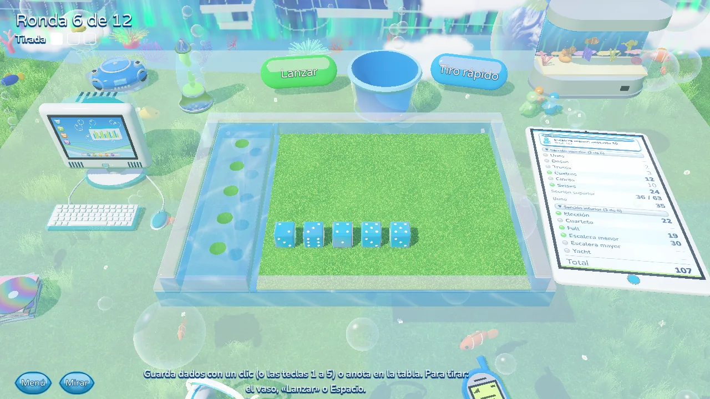
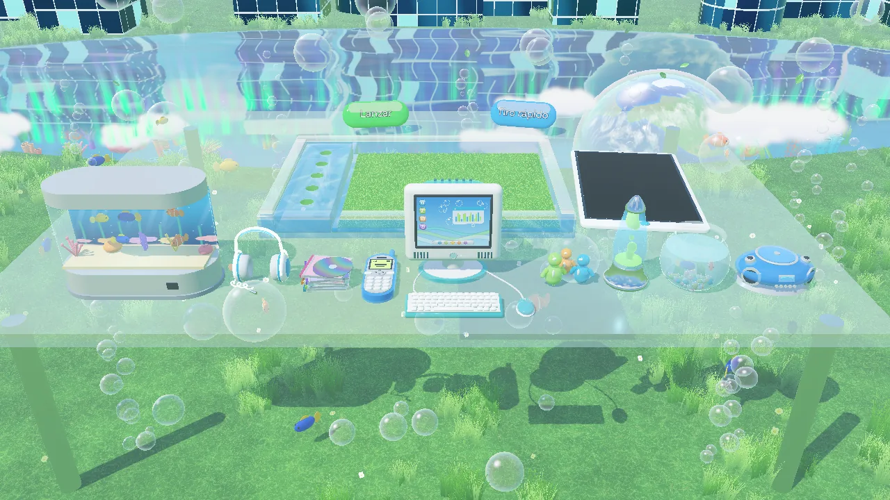
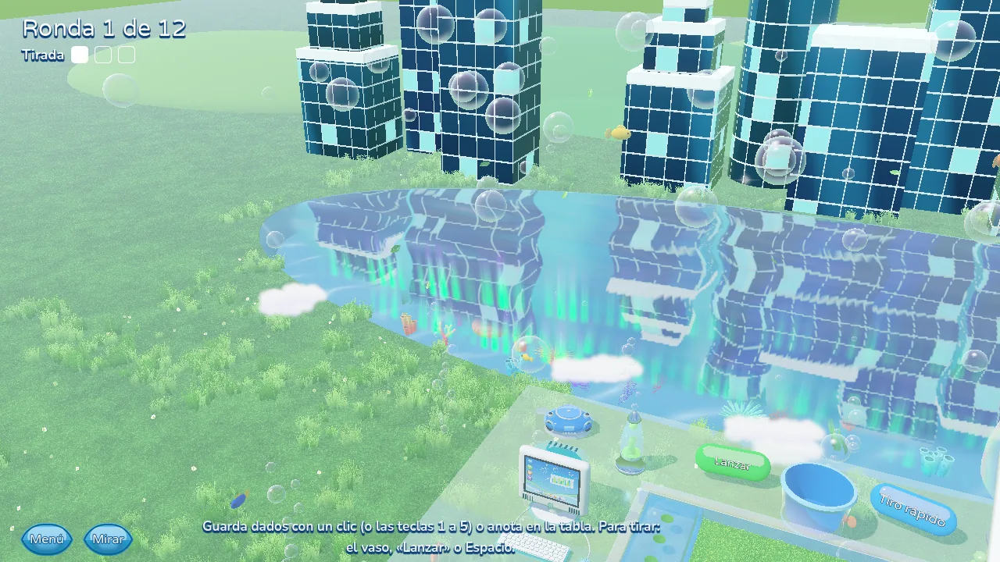
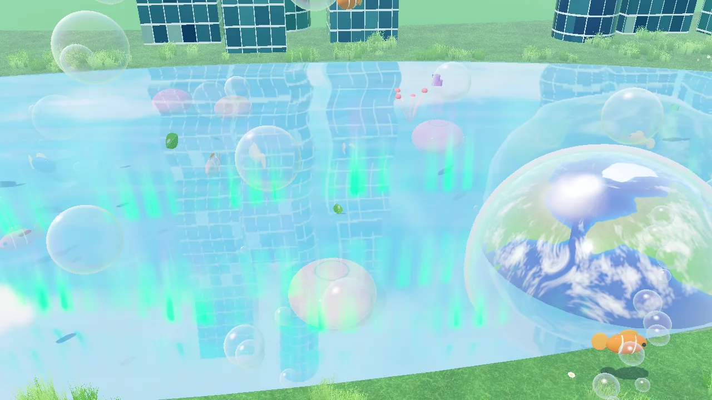
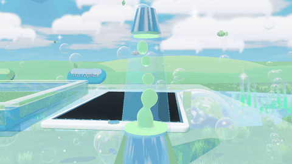

[Español](aero.es.md) · **English**

# Frutiger Aero

The look of glossy mid-2000s computers, taken outdoors: a glass table on a meadow, next to a crystal-clear lake with coral, fish, glass buildings reflected in the water and auroras in the sky. Bubbles rise from the grass and clouds drift by.

- **Score sheet:** a glass tablet laid out as a contact list; with two players it becomes a chat conversation, with the current turn inside a gel speech bubble.
- **Dice:** aquamarine resin.
- **Buttons:** glossy gel pills, in several colours.
- **Life:** fish, bubbles, falling leaves, drifting clouds and, now and then, a dolphin.
- **Objects:** an aquarium, a computer, headphones, a lava lamp, a retro phone, CDs, a radio, glass figurines and a fishbowl.

## Gallery

*The glass table over the meadow.*

*The score sheet is a glass tablet.*

*Aquamarine resin dice.*

*Aquarium, computer, headphones, lava lamp and more.*

*Looking around: the lake and the glass buildings.*

*Auroras over the water and a glass Earth.*

*The wax in the lava lamp.*

---

[Back to the start](../README.en.md) · [Evolution](../EVOLUTION.md)
