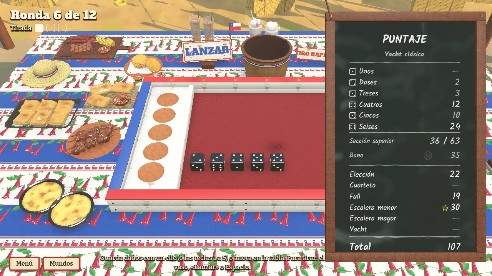
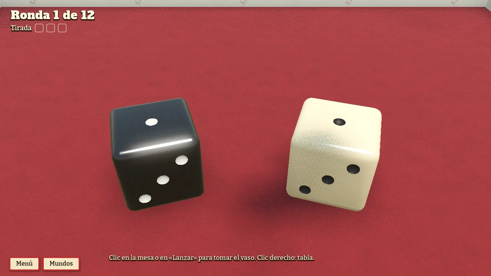
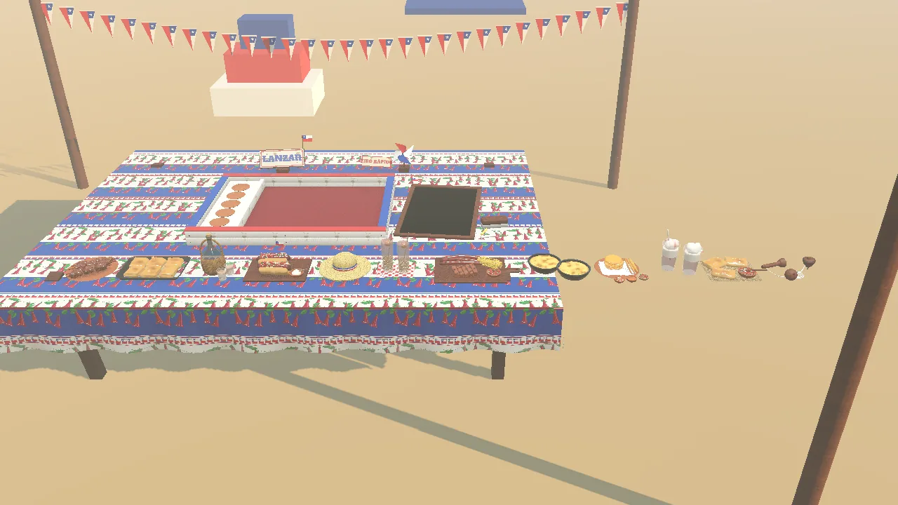
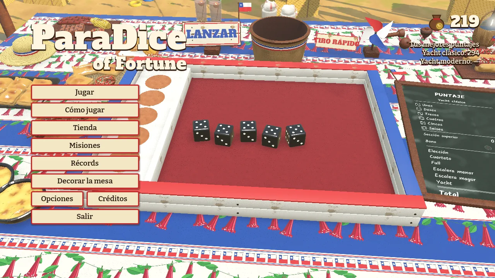
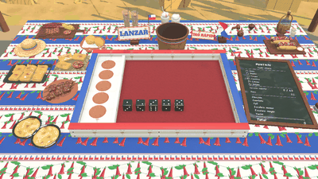

**English** · [Español](fonda.es.md)

# Fonda El Cacho

A Chilean fonda for the Independence Day holidays («Fiestas Patrias»), on a sunny afternoon, with a realistic tone. Under an awning hung with flags and bunting, kites fly in the wind, the grill smokes and an organ grinder walks past now and then.

- **Score sheet:** a chalkboard, written in chalk.
- **Cup:** the «cacho», the traditional leather dice cup of Chile.
- **Dice:** on a red cloth, with stone dice and patriotic dice as alternatives.
- **Tablecloths:** copihue flowers and other designs; afternoon and evening, with string lights.
- **Life:** bunting and kites in a gusty wind, whirligigs, smoke, birds, the awning, the fire and a hopscotch court.
- **Objects:** empanadas, anticuchos, choripanes, a barbecue platter, pastel de choclo, sopaipillas, mote con huesillo, chicha, terremotos, a straw hat and a spinning top.

## Gallery

*The fonda's table, on the copihue tablecloth.*

*The chalkboard, written in chalk.*

*The dice on the cloth.*

*Empanadas, anticuchos, mote con huesillo, terremotos and a spinning top.*

*Looking around: the grill, the bunting and the kites.*

*The main menu at the fonda.*

*The bunting and the kites in the wind.*

---

[Back to the start](../README.md) · [Evolution](../EVOLUTION.md)
