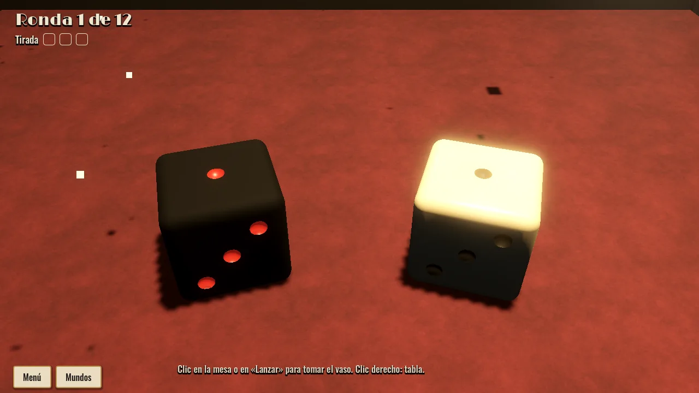
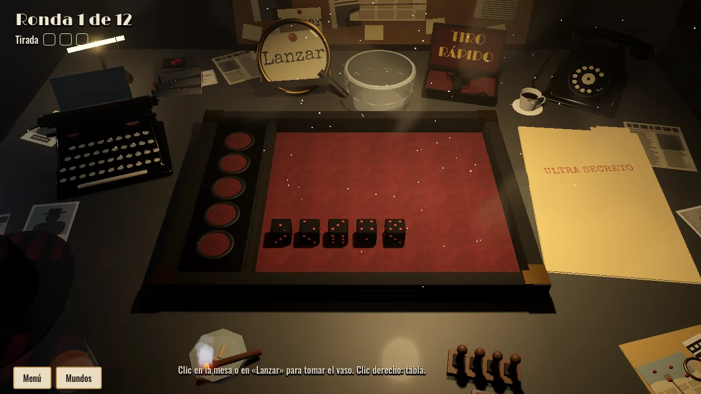
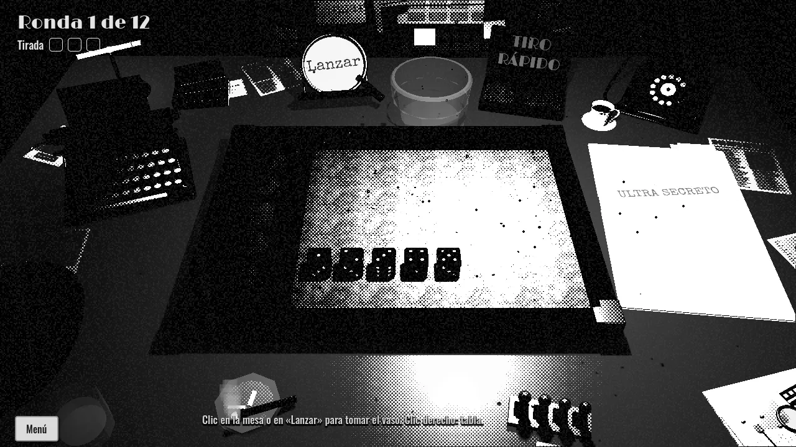
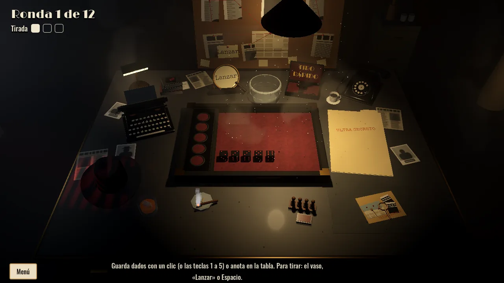
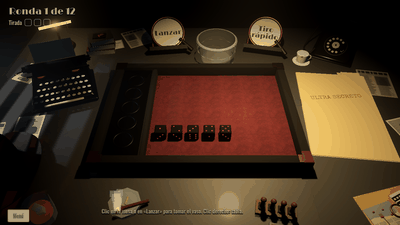

**English** · [Español](noir.es.md)

# Midnight Agency (noir office)

A private detective's office in the 1940s, at midnight. A hanging lamp lights the desk, the light from the blinds falls across the room, a neon sign flickers outside, rain runs down the window and car headlights sweep the ceiling.

- **Score sheet:** a case file in a cardboard folder that opens as it comes closer, filled in on the typewriter key by key. The top score in a box leaves a bullet hole.
- **Dice:** on a red baize.
- **Buttons:** a magnifying glass over a clue board, and a revolver case for the quick throw.
- **Palettes:** several colour palettes, including **Ink**, a black-and-white comic look.
- **Life:** rain, neon, a ceiling fan, a silhouette behind the frosted glass, a passing train, smoke and footsteps.
- **Objects:** a telephone, a revolver, a fedora, a bottle of whisky, a radio, a cup of coffee and more.

## Gallery

*The desk: typewriter, telephone and the case file.*

*The open case file, typewritten.*

*Two sets of dice on the red baize.*

*Cigarette smoke under the lamp.*

*The Ink palette.*

*The wide view of the office.*

*The folder opens as it comes closer.*

---

[Back to the start](../README.md) · [Evolution](../EVOLUTION.md)
