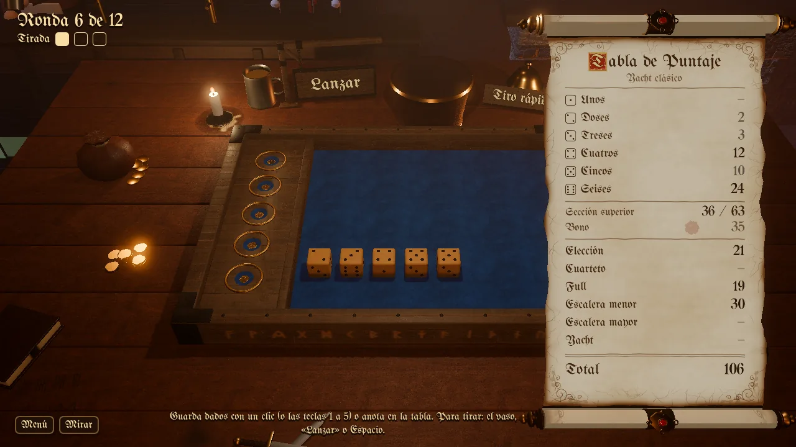
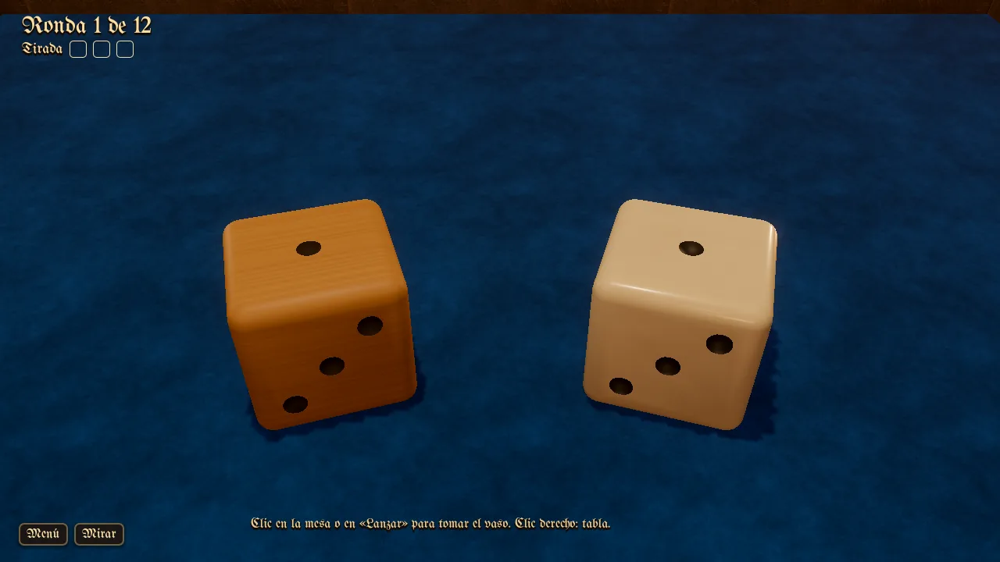
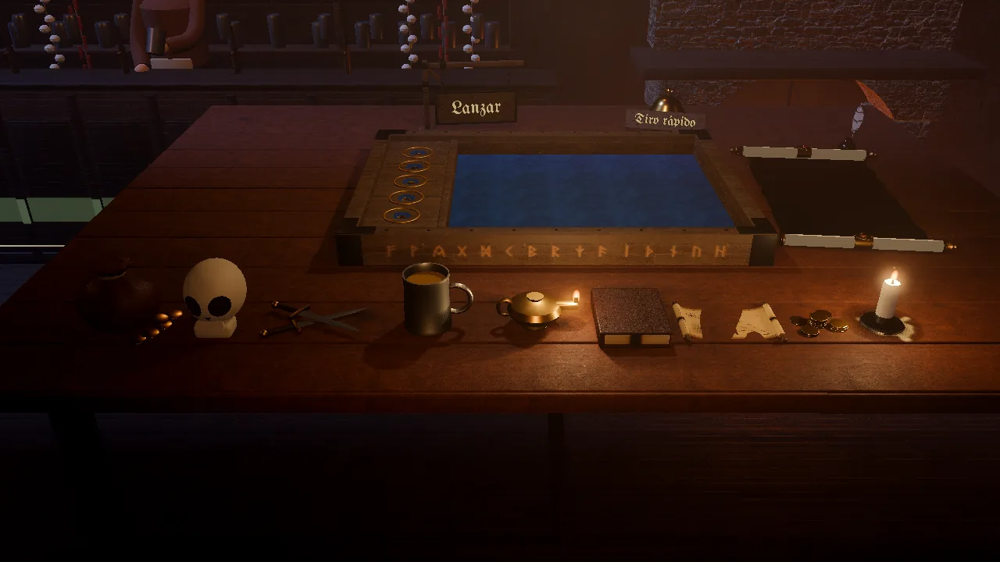
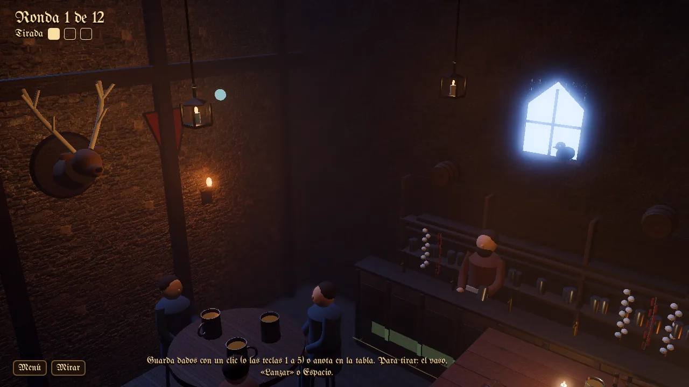
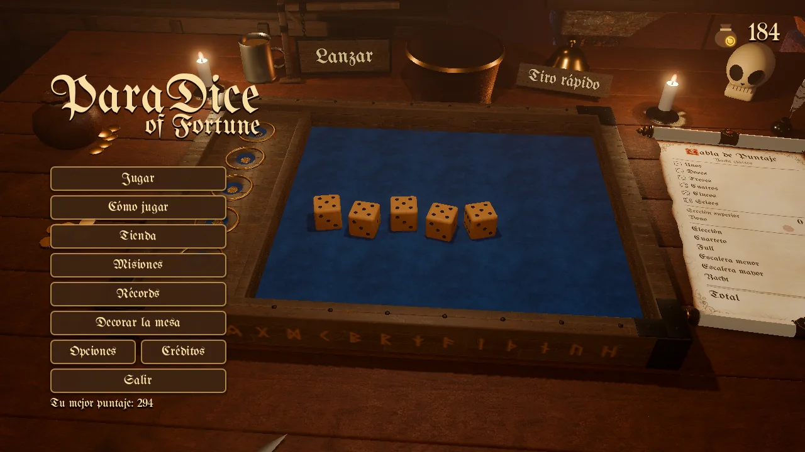
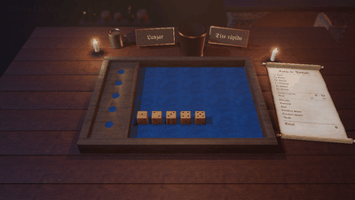

[Español](posada.es.md) · **English**

# The Oak Inn

The first world and the one every profile starts with: a fantasy tavern, realistic and warm. Candles light the table, the wood shows its grain, and the dice land on a midnight-blue baize framed in oak with carved runes.

- **Score sheet:** a parchment scroll that rises towards the screen when the mouse passes over it, with an illuminated initial, a quill and an inkwell. Numbers are written with ink that burns in.
- **Dice:** boxwood by default, bone as an alternative.
- **Buttons:** a hanging inn sign and a bar bell.
- **Life:** patrons murmuring, a fire, a cat, a door bell when someone comes in, and lightning with thunder through the window.
- **Objects:** a skull, a tankard, a dagger, an old book, an oil lamp, a candle, coins and a treasure map.

## Gallery

*The inn's table, among candles, a tankard and a skull.*

*The parchment score sheet, with an illuminated initial.*

*Boxwood and bone dice on the cloth.*

*The inn's table objects.*

*Looking around: the tavern and its patrons.*

*The main menu at the inn.*

*Scoring with the quill and rolling up the parchment.*

---

[Back to the start](../README.en.md) · [Evolution](../EVOLUTION.md)
